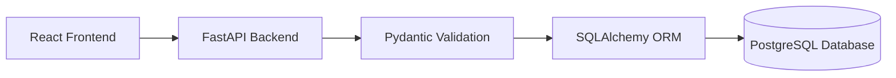

# CareConnect – Pediatrician Online Consultation Platform 🩺👶

CareConnect is an end-to-end, full-stack pediatric telemedicine and online consultation platform designed to connect parents and legal guardians directly with verified pediatricians. Built with **React 18, Vite, TypeScript, Tailwind CSS, FastAPI, SQLAlchemy ORM, WebSockets, ReportLab, and PostgreSQL/SQLite**, CareConnect delivers a modern, secure digital clinic experience.

---

## 🌐 Live Demo & Deployment

The application is deployed and publicly accessible in production:

- **Live Web Application:** [https://care-connect-kappa-cyan.vercel.app](https://care-connect-kappa-cyan.vercel.app)
- **Backend API Service:** [https://careconnect-backend-8np1.onrender.com](https://careconnect-backend-8np1.onrender.com)
- **Interactive OpenAPI Documentation:** [https://careconnect-backend-8np1.onrender.com/docs](https://careconnect-backend-8np1.onrender.com/docs)

*Note: The backend service is hosted on Render's free tier. If the service has been inactive for more than 15 minutes, the first incoming request may take 30–50 seconds to wake up the cloud container. All subsequent requests respond instantaneously.*

---

## 🌟 Key Capabilities & Features

### 1. 👨‍👩‍👧 Parent Module
- **Registration & Authentication**: Secure JWT-based session management with role-based access control and affirmative guardian consent.
- **Multi-Child Health Profiles**: Manage profiles for multiple children under a single guardian account (date of birth, age, blood group, allergies, existing medical conditions, and medical history).
- **Appointment Scheduling**: Interactive calendar booking showing real-time doctor availability with automatic conflict removal and server-side double-booking prevention (HTTP 409).
- **Prescription Vault**: Instantly access and download digitally generated PDF prescriptions created during pediatric consultations.
- **Medical Records**: Securely upload and store child immunization records, lab test reports, and imaging documents.

### 2. 🩺 Doctor Dashboard
- **Consultation Schedule**: Overview of today’s patient queue, start times, chief medical complaints, and child details.
- **Interactive Video Clinic**: Conduct encrypted video consultations powered by Jitsi Meet with duration tracking, fullscreen controls, and clinical summary access.
- **Digital Prescription Generator**: Formally issue prescriptions with dynamic medication rows (medicine name, dosage, frequency, duration, administration instructions) and automatic ReportLab PDF creation.
- **Availability Manager**: Configure working hours by day, slot duration (15/30/45 mins), break timings (e.g. 13:00 - 14:00), and block out dates for leave or unavailability.

### 3. 💬 Real-Time Messaging & Notifications
- **WebSocket Chat**: Low-latency, one-to-one messaging between parent and pediatrician linked directly to the consultation.
- **Live Typing Indicators & Read Receipts**: Real-time typing status and message delivery confirmation.
- **Prescription In-Chat Cards**: Digital prescriptions are rendered directly into the consultation chat thread with one-click PDF downloads.
- **In-App Notifications**: Alerts for appointment bookings, confirmations, doctor messages, and prescription generation.

### 4. 🛡️ Administrator & Security Oversight
- **Platform Analytics**: Interactive KPI metrics and charts for user distribution, appointments, and prescriptions.
- **Pediatrician Verification**: Admin review of doctor registration licenses with an instant verification toggle.
- **Audit Logging**: Security audit trail recording user logins, appointment bookings, and prescription actions with timestamp and IP tracking.

---

## 🏗️ Technology Stack

| Layer | Technologies |
|---|---|
| **Frontend** | React 18, TypeScript, Vite, Tailwind CSS, React Router v6, Axios, Lucide React, Recharts |
| **Backend** | Python 3.11, FastAPI, SQLAlchemy ORM, Pydantic v2, Uvicorn |
| **Database** | PostgreSQL (Production) & SQLite (Local development) |
| **Migrations** | Alembic |
| **Real-time** | WebSockets (Chat & In-app Notifications) |
| **Video Calls** | Jitsi Meet Integration (Unique Consultation Rooms) |
| **PDF Generation** | ReportLab (Pediatric Letterhead, Rx Table, Consultation Details) |
| **Security** | BCrypt password hashing, JWT Bearer tokens, Role-Based Access Control (RBAC) |

---

## 🔑 Demo Access & Testing

For testing and evaluation:
- Visitors can self-register a new **Parent Account** directly through the registration page.
- Pre-configured demo accounts for **Doctor**, **Parent**, and **Administrator** roles are accessible via the **1-Click Demo Login** shortcuts provided directly on the application's login screen.
- In accordance with healthcare data privacy best practices, actual user credentials and personal health details are not published in public documentation.

---

## 🚀 Quickstart & Local Setup

### Prerequisites
- Python 3.10+
- Node.js 18+ and npm

### 1. Database & Seed Data Setup
```bash
# Navigate to backend
cd backend

# Install Python requirements
pip install -r requirements.txt

# Run Database Migrations and Seed Sample Data
python seed.py
```

### 2. Run Backend API Server
```bash
# Start FastAPI backend (runs on http://127.0.0.1:8000)
python -m uvicorn app.main:app --host 127.0.0.1 --port 8000 --reload
```
- Interactive Swagger OpenAPI Documentation: [http://127.0.0.1:8000/docs](http://127.0.0.1:8000/docs)

### 3. Run Frontend Application
```bash
# In a separate terminal, navigate to frontend
cd frontend

# Install npm packages
npm install

# Start Vite dev server (runs on http://localhost:5173)
npm run dev
```
Open **[http://localhost:5173](http://localhost:5173)** in your browser.

---

## 🧪 Automated Test Suite

A comprehensive test suite verifies authentication, parent-child data isolation, doctor slot availability, appointment double-booking prevention (HTTP 409), digital prescription PDF generation, and admin metrics:

```bash
# Run backend test suite
cd backend
python test_suite.py
```

All test suites execute with zero failures:
```
[PASS] Root Health check passed
[PASS] Authentication & Role-based tokens passed
[PASS] Parent-Child CRUD & Cross-parent security isolation passed
[PASS] Appointment booking & Double-booking prevention rule verified (HTTP 409 Conflict)
[PASS] Digital Prescription & ReportLab PDF download verified
[PASS] Admin Dashboard metrics and user auditing verified
```

---

## 🐳 Docker Deployment

To launch the entire platform with PostgreSQL, FastAPI backend, and frontend in Docker:

```bash
docker-compose up --build
```
- Frontend: `http://localhost:5173`
- Backend API: `http://localhost:8000`
- PostgreSQL: `localhost:5432`

---

## 📋 Healthcare Workflow & Privacy Safeguards

- **Guardian Consent Verification**: Affirmative guardian consent checkboxes during registration and booking.
- **Pediatrician Verification**: Administrative review and verification of pediatrician profiles and medical license credentials.
- **Patient Data Isolation**: Children's health profiles and digital prescriptions are strictly isolated by account with role-based authorization checks preventing unauthenticated or cross-family access.
- **Protected Medical Documents**: Prescription PDFs and medical records return HTTP 401 Unauthorized for unauthenticated requests and HTTP 403 Forbidden for cross-user attempts.

---

## 🏛️ Backend Architecture & Database Management

CareConnect uses a Python-based backend built with FastAPI, SQLAlchemy ORM and PostgreSQL to handle application logic and data management.

### Technology Responsibilities

| Technology | Purpose |
|---|---|
| **Python** | Implements backend application logic. |
| **FastAPI** | Handles API requests and responses between the frontend and backend. |
| **Pydantic** | Validates incoming and outgoing data. |
| **SQLAlchemy ORM** | Connects Python application models with database tables and performs database operations. |
| **Alembic** | Manages database schema changes through migration scripts. |
| **Mako** | Provides the template used by Alembic to generate migration scripts. |
| **PostgreSQL** | Stores application data in the production environment. |

### Application Data Flow

When a parent registers or adds a child profile:

1. The React frontend sends the request to the FastAPI backend.
2. Pydantic validates the submitted data.
3. FastAPI processes the request using the application logic.
4. SQLAlchemy performs the required database operations.
5. PostgreSQL stores the information.
6. The backend returns a response to the frontend.



### Database Migration Management

Alembic is used to manage changes to the database structure, such as adding columns or creating tables. It generates migration scripts using its Mako template and applies approved changes to the database.

**Note:** SQLAlchemy handles regular database operations, whereas Alembic manages database structure changes.

